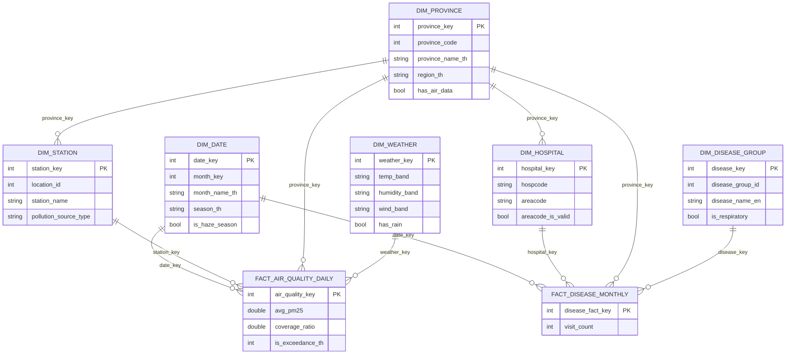

# Data Warehouse Design — Star Schema

**โครงการวิเคราะห์ความสัมพันธ์ระหว่างฝุ่น PM2.5 กับผู้ป่วยโรคระบบทางเดินหายใจ**

เอกสารนี้อธิบายการออกแบบ Dimensional Model ทั้งหมดใน `03_Data_Warehouse/dw.duckdb`
สร้างด้วย `02_ETL/03_transform/build_star_schema.py`

---

## 1. ภาพรวม

Warehouse ประกอบด้วย **6 Dimension Tables + 2 Fact Tables + 1 Aggregate Table**



**จุดที่ทำให้เป็น Star ไม่ใช่ Snowflake:** ทุก dimension ต่อกับ fact โดยตรง ไม่มี dimension
ที่ต้องผ่าน dimension อื่นก่อน (ยกเว้น `province_key` ใน DIM_STATION/DIM_HOSPITAL ซึ่งเป็น
การเก็บความสัมพันธ์เชิงภูมิศาสตร์ไว้ ไม่ได้บังคับให้ query ต้องผ่าน)

---

## 2. แนวคิดที่ใช้ในการออกแบบ

### 2.1 Grain (ความละเอียดของข้อมูล)

**Grain คือคำตอบของคำถาม "1 แถวใน Fact Table หมายถึงอะไร"** ต้องประกาศให้ชัดก่อนออกแบบอย่างอื่น
เพราะมันกำหนดว่า dimension ใดต่อได้บ้าง และ measure ใดรวมกันได้

| Fact | Grain |
|---|---|
| `FACT_AIR_QUALITY_DAILY` | 1 แถว = ผลการวัดคุณภาพอากาศของ **1 สถานี ใน 1 วัน** |
| `FACT_DISEASE_MONTHLY` | 1 แถว = จำนวนครั้งการรับบริการของ **1 โรงพยาบาล ใน 1 เดือน ของ 1 กลุ่มโรคย่อย** |

### 2.2 Surrogate Key (SK) เทียบกับ Natural Key (NK)

**Natural Key** คือรหัสจากระบบต้นทาง เช่น `hospcode = '04182'` หรือ `location_id = 2326`
**Surrogate Key** คือเลขที่ warehouse สร้างขึ้นเอง เช่น `hospital_key = 1234`

Fact Table เก็บเฉพาะ SK ไม่เก็บ NK เพราะ:

1. **ไม่ผูกกับระบบต้นทาง** — ถ้าวันหนึ่ง สธ. เปลี่ยนรูปแบบ `hospcode` แก้แค่ dimension
   ไม่ต้องแตะ fact 1.7 ล้านแถว
2. **เร็วกว่า** — join ด้วย INTEGER เร็วกว่า VARCHAR
3. **รองรับข้อมูลที่เปลี่ยนตามเวลา** (SCD)

ทุก SK ในโปรเจกต์นี้สร้างด้วย `ROW_NUMBER() OVER (ORDER BY <natural key>)`
เรียงตาม NK เสมอ **จึงรันซ้ำกี่ครั้งก็ได้เลขเดิม (deterministic)** ไม่ต้องกลัวว่ารัน ETL ใหม่
แล้วเลขจะสลับ

### 2.3 Conformed Dimension

`DIM_DATE` และ `DIM_PROVINCE` ถูกใช้ร่วมกันโดย **fact ทั้งสองตัว** เรียกว่า conformed dimension

นี่คือ**หัวใจของโครงการ** เพราะ `DIM_PROVINCE` คือจุดเดียวที่ข้อมูลฝั่งฝุ่น (OpenAQ)
กับฝั่งผู้ป่วย (HDC) มาบรรจบกันได้ ถ้าไม่มี dimension ร่วม ข้อมูล 4 แหล่งจะยังเป็น 4 ก้อนแยกกัน

---

## 3. Dimension Tables

### 3.1 `DIM_DATE` — 3,652 แถว

ปฏิทิน 1 ม.ค. 2017 ถึง 31 ธ.ค. 2026 **สร้างขึ้นเอง ไม่ได้มาจากแหล่งข้อมูลใด**

| คอลัมน์ | ชนิด | คำอธิบาย |
|---|---|---|
| `date_key` | INTEGER | **PK** รูปแบบ `YYYYMMDD` เช่น `20240215` |
| `full_date` | TIMESTAMP | วันที่จริง |
| `year`, `quarter`, `month`, `day` | BIGINT | องค์ประกอบของวันที่ |
| `year_be` | BIGINT | **ปี พ.ศ.** (= `year` + 543) สำหรับสื่อสารกับผู้ใช้ไทย |
| `month_key` | INTEGER | รูปแบบ `YYYYMM` เช่น `202402` ใช้ rollup รายเดือน |
| `month_name_th` | VARCHAR | มกราคม, กุมภาพันธ์, … |
| `season_th` | VARCHAR | ฤดูหนาว (พ.ย.–ก.พ.) / ฤดูร้อน (มี.ค.–พ.ค.) / ฤดูฝน (มิ.ย.–ต.ค.) |
| `is_haze_season` | BOOLEAN | TRUE ในเดือน ธ.ค.–เม.ย. ซึ่งเป็นช่วงฝุ่นสูงของไทย |

**ตัวอย่างข้อมูล**

| date_key | full_date | year_be | month_key | month_name_th | season_th | is_haze_season |
|---|---|---|---|---|---|---|
| 20220101 | 2022-01-01 | 2565 | 202201 | มกราคม | ฤดูหนาว | true |
| 20250715 | 2025-07-15 | 2568 | 202507 | กรกฎาคม | ฤดูฝน | false |

> **ทำไมใช้ `YYYYMMDD` เป็น PK แทน `DATE`** — อ่านง่ายด้วยตาเวลา debug, เรียงลำดับได้ถูกต้อง
> โดยไม่ต้องแปลงชนิด และเป็นแนวปฏิบัติมาตรฐานของ Kimball

> **ทำไม fact รายเดือนก็ยังใช้ DIM_DATE ตัวนี้** — `FACT_DISEASE_MONTHLY` ชี้ไปที่
> **วันที่ 1 ของเดือน** เสมอ (เช่น `20230401` แทนเดือน เม.ย. 2023) ทำให้ไม่ต้องสร้าง
> `DIM_MONTH` แยก และยัง rollup ด้วย dimension เดียวกันได้

### 3.2 `DIM_PROVINCE` — 77 แถว

| คอลัมน์ | ชนิด | ที่มา |
|---|---|---|
| `province_key` | BIGINT | **PK** (SK) |
| `province_code` | BIGINT | NK — รหัสจังหวัด 2 หลัก เช่น 10 = กรุงเทพฯ |
| `province_name_th` | VARCHAR | จากไฟล์ HDC |
| `region_th` | VARCHAR | **คำนวณจาก `province_code`** (ดูกฎข้างล่าง) |
| `population` | BIGINT | จากไฟล์ประชากร — **ปัจจุบันเป็น NULL ทั้ง 77 แถว** |
| `has_air_data` | BOOLEAN | TRUE เฉพาะ 51 จังหวัดที่มีสถานีวัดฝุ่น |

**กฎการหาภูมิภาคจากรหัสจังหวัด**

| ช่วงรหัส | ภูมิภาค |
|---|---|
| 10–19, 60–61, 72–75 | ภาคกลาง |
| 20–27 | ภาคตะวันออก |
| 30–49 | ภาคตะวันออกเฉียงเหนือ |
| 50–58, 62–67 | ภาคเหนือ |
| 70, 71, 76, 77 | ภาคตะวันตก |
| 80–96 | ภาคใต้ |

> **`has_air_data` มีไว้ทำไม** — warehouse เก็บผู้ป่วยครบ 77 จังหวัด แต่มีข้อมูลฝุ่น 51 จังหวัด
> ธงนี้ทำให้ Dashboard filter ได้ทันทีว่าจังหวัดใดวิเคราะห์ความสัมพันธ์ได้ และจังหวัดใด
> ใช้เป็นบริบทเปรียบเทียบเท่านั้น

### 3.3 `DIM_STATION` — 54 แถว

| คอลัมน์ | ชนิด | คำอธิบาย |
|---|---|---|
| `station_key` | BIGINT | **PK** (SK) |
| `location_id` | INTEGER | NK — รหัสสถานีของ OpenAQ |
| `station_name`, `locality` | VARCHAR | ชื่อและพื้นที่ |
| `province_key` | BIGINT | FK → DIM_PROVINCE |
| `lat`, `lon`, `elevation_m` | DOUBLE | พิกัดและความสูง |
| `pollution_source_type` | VARCHAR | **ประเภทแหล่งกำเนิดมลพิษ** |
| `air4thai_station_id` | VARCHAR | รหัสสถานีของกรมควบคุมมลพิษที่จับคู่ได้ |

**การกระจายของ 54 สถานี ครอบคลุม 51 จังหวัด**

| ภาค | สถานี |
|---|---|
| ภาคกลาง | 16 |
| ภาคเหนือ | 12 |
| ภาคตะวันออกเฉียงเหนือ | 10 |
| ภาคใต้ | 8 |
| ภาคตะวันออก | 6 |
| ภาคตะวันตก | 2 |

**แยกตามประเภทแหล่งกำเนิดมลพิษ**

| ประเภท | สถานี |
|---|---|
| ผสม (เมือง+เกษตร) | 29 |
| การเผาในที่โล่ง | 12 |
| อุตสาหกรรม | 8 |
| จราจร | 5 |

> เลือก **1 สถานีต่อ 1 จังหวัด** เพราะหน่วยวิเคราะห์คือจังหวัด-เดือน การเพิ่มสถานีที่ 2
> ในจังหวัดเดิมจะเพิ่มไฟล์ที่ต้องโหลดแต่ไม่เพิ่มหน่วยวิเคราะห์เลย
> ข้อยกเว้นคือ กทม. (3 สถานี) และสมุทรสาคร (2 สถานี) ที่คงไว้จากชุดข้อมูลเดิม
> ทำให้ 54 สถานีครอบคลุม 51 จังหวัด

> **`air4thai_station_id` ได้มาอย่างไร** — OpenAQ ใช้ `location_id` เป็นตัวเลข ส่วน Air4Thai
> ใช้รหัสแบบ `"05t"` ไม่มีคีย์ร่วม จึง**จับคู่ด้วยพิกัด** โดยหาสถานี Air4Thai ที่ใกล้ที่สุด
> ภายในรัศมี 0.05 องศา (~5 กม.) — เป็นตัวอย่างการแก้ปัญหา Mismatched Keys

> **`pollution_source_type` มีประโยชน์อย่างไร** — ทำให้เปรียบเทียบได้ว่าฝุ่นจากการเผา
> (เหนือ) กับฝุ่นจากจราจร (กทม.) ส่งผลต่อผู้ป่วยต่างกันหรือไม่ ซึ่งตอบ BQ3 ได้ลึกกว่า
> การเทียบรายจังหวัดเฉย ๆ

### 3.4 `DIM_HOSPITAL` — 11,609 แถว

| คอลัมน์ | ชนิด | คำอธิบาย |
|---|---|---|
| `hospital_key` | BIGINT | **PK** (SK) |
| `hospcode` | VARCHAR | NK — รหัสสถานพยาบาล 5 หลัก |
| `areacode` | VARCHAR | รหัสพื้นที่ 8 หลัก |
| `areacode_is_valid` | BOOLEAN | FALSE สำหรับ 1,082 แถวที่รูปแบบผิด (ลงท้ายด้วย `-`) |
| `province_key` | BIGINT | FK → DIM_PROVINCE |

**ปัญหาที่ต้องจัดการ: `areacode` เปลี่ยนข้ามปี**

โรงพยาบาล 271 แห่งมี `areacode` มากกว่า 1 ค่าในช่วง 2022–2025 (เกิดจากการปรับเขตพื้นที่)
ถ้าไม่จัดการ 1 hospcode จะกลายเป็นหลายแถวใน dimension

**วิธีแก้: SCD Type 1** — เก็บเฉพาะค่าล่าสุด ทับค่าเก่าทิ้ง

```sql
ROW_NUMBER() OVER (PARTITION BY hospcode ORDER BY year_ce DESC, month_no DESC) = 1
```

เลือก Type 1 ไม่ใช่ Type 2 เพราะ `areacode` เป็นข้อมูลบริหาร ไม่กระทบการวิเคราะห์เชิงสุขภาพ
การเก็บประวัติจะทำให้ dimension ใหญ่ขึ้นโดยไม่ได้ประโยชน์

> **ตรวจสอบแล้วว่าปลอดภัย** — ไม่มี hospcode ใดอยู่ข้ามจังหวัด (0 violations)
> `province_key` จึงเก็บใน dimension ได้อย่างมั่นใจ

### 3.5 `DIM_DISEASE_GROUP` — 12 แถว

| คอลัมน์ | ชนิด | คำอธิบาย |
|---|---|---|
| `disease_key` | BIGINT | **PK** (SK) |
| `disease_group_id`, `disease_sub_group_id` | BIGINT | NK คู่ |
| `disease_name_en` | VARCHAR | ชื่อโรคภาษาอังกฤษ |
| `disease_group_name_th` | VARCHAR | ชื่อกลุ่มโรคภาษาไทย |
| `related_icd10_example` | VARCHAR | ตัวอย่างรหัส ICD-10 |
| `confidence` | VARCHAR | ความมั่นใจของ mapping |
| `is_respiratory` | BOOLEAN | TRUE เมื่อ `disease_group_id = 1` |

**ข้อมูลทั้ง 12 แถว**

| key | group | sub | ชื่อโรค | กลุ่ม | ICD-10 | respiratory |
|---|---|---|---|---|---|---|
| 1 | 1 | 1 | COPD | ทางเดินหายใจ | – | ✅ |
| 2 | 1 | 2 | Asthma | ทางเดินหายใจ | – | ✅ |
| 3 | 1 | 3 | Pneumonia | ทางเดินหายใจ | – | ✅ |
| 4 | 1 | 4 | Influenza | ทางเดินหายใจ | – | ✅ |
| 5 | 1 | 5 | Acute pharyngitis | ทางเดินหายใจ | J029 | ✅ |
| 6 | 1 | 6 | Chronic rhinitis | ทางเดินหายใจ | – | ✅ |
| 7 | 1 | 7 | Bronchitis | ทางเดินหายใจ | – | ✅ |
| 8 | 2 | 1 | Acute ischemic heart disease | หัวใจ/หลอดเลือดสมอง | – | ❌ |
| 9 | 2 | 2 | Cerebrovascular disease (stroke) | หัวใจ/หลอดเลือดสมอง | – | ❌ |
| 10 | 3 | 0 | กลุ่มโรคตาอักเสบ | ตา | H10 | ❌ |
| 11 | 4 | 0 | กลุ่มโรคผิวหนังอักเสบ | ผิวหนัง | L23 | ❌ |
| 12 | 6 | 0 | Long-term effect | ผลกระทบระยะยาว | – | ❌ |

> **ทำไมเก็บกลุ่มที่ไม่ใช่ทางเดินหายใจไว้ด้วย** — กลุ่มโรคตา (key 10) และผิวหนัง (key 11)
> ใช้เป็น **กลุ่มควบคุม (control group)** ถ้าผู้ป่วยทุกกลุ่มขึ้นลงพร้อมกันหมด
> แปลว่าเป็นผลจากฤดูกาลหรือพฤติกรรมการมาโรงพยาบาล ไม่ใช่ผลของฝุ่นโดยเฉพาะ

> **กลุ่มที่ 5 หายไปไหน** — `disease_group_id = 5` ระบุใน `disease_map.csv` ว่า
> `confidence = unconfirmed` (ยังยืนยันความหมายไม่ได้) จึงไม่นำเข้า warehouse
> เพื่อไม่ให้ตัวเลขที่ตีความไม่ได้ปนเข้าไปในผลวิเคราะห์

### 3.6 `DIM_WEATHER` — 50 แถว

**Junk Dimension** — รวมตัวแปรสภาพอากาศที่จัดกลุ่มแล้วไว้ในตารางเดียว

| คอลัมน์ | ชนิด | ค่าที่เป็นไปได้ |
|---|---|---|
| `weather_key` | BIGINT | **PK** (SK) |
| `temp_band` | VARCHAR | เย็น (<25°C) / ปกติ (25–30°C) / ร้อน (>30°C) |
| `humidity_band` | VARCHAR | แห้ง (<60%) / ปกติ (60–75%) / ชื้น (>75%) |
| `wind_band` | VARCHAR | ลมสงบ (<10 km/h) / ลมปกติ (10–20) / ลมแรง (>20) |
| `has_rain` | BOOLEAN | มีฝน / ไม่มีฝน |

**ตัวอย่าง**

| weather_key | temp_band | humidity_band | wind_band | has_rain |
|---|---|---|---|---|
| 1 | ปกติ (25-30°C) | ชื้น (>75%) | ลมปกติ (10-20 km/h) | false |
| 2 | ปกติ (25-30°C) | ชื้น (>75%) | ลมปกติ (10-20 km/h) | true |

> **ทำไมต้องจัด bin แทนที่จะเก็บตัวเลขดิบ** — อุณหภูมิ 27.3°C เป็นค่าต่อเนื่อง
> ถ้าเก็บเป็น dimension จะได้หลายพันแถวและ filter บน Dashboard ไม่ได้
> การจัดเป็นกลุ่มทำให้ผู้ใช้เลือกได้ว่า "ดูเฉพาะวันที่ลมสงบ" ซึ่งตอบ BQ5 ได้ตรง
> (3 × 3 × 3 × 2 = 54 ชุดที่เป็นไปได้ เกิดขึ้นจริง 50 ชุด)

---

## 4. Fact Tables

### 4.1 `FACT_AIR_QUALITY_DAILY` — 35,316 แถว

> **Grain: 1 แถว = ผลการวัดคุณภาพอากาศของ 1 สถานี ใน 1 วัน**

| คอลัมน์ | ชนิด | ประเภท | คำอธิบาย |
|---|---|---|---|
| `air_quality_key` | BIGINT | **PK** | SK |
| `date_key` | INTEGER | **FK** | → DIM_DATE |
| `station_key` | BIGINT | **FK** | → DIM_STATION |
| `province_key` | BIGINT | **FK** | → DIM_PROVINCE |
| `weather_key` | BIGINT | **FK** | → DIM_WEATHER |
| `avg_pm25` | DOUBLE | Measure | ค่าเฉลี่ย PM2.5 ของวันนั้น (µg/m³) |
| `max_pm25`, `min_pm25` | DOUBLE | Measure | ค่าสูงสุด/ต่ำสุดของวัน |
| `n_readings` | BIGINT | Measure | จำนวนชั่วโมงที่วัดได้ (18–24) |
| `coverage_ratio` | DOUBLE | Measure | `n_readings / 24` — ความครบถ้วนของวันนั้น |
| `is_exceedance_th` | INTEGER | Measure | 1 = เกินมาตรฐานไทย 37.5 µg/m³ |
| `is_exceedance_who` | INTEGER | Measure | 1 = เกินแนวทาง WHO 15 µg/m³ |

**ตัวอย่างข้อมูล**

| key | date_key | station_key | province_key | weather_key | avg_pm25 | n_readings | coverage_ratio | exceed_th | exceed_who |
|---|---|---|---|---|---|---|---|---|---|
| 1 | 20220101 | 1 | 12 | 12 | 11.74 | 23 | 0.958 | 0 | 0 |
| 2 | 20220102 | 1 | 12 | 12 | 14.38 | 24 | 1.000 | 0 | 0 |
| 3 | 20220104 | 1 | 12 | 12 | 19.46 | 24 | 1.000 | 0 | 1 |

**ประเภทของ Measure**

| Measure | รวมข้าม dimension ได้ไหม | หมายเหตุ |
|---|---|---|
| `is_exceedance_th/who` | ✅ Additive | `SUM()` ได้ = จำนวนวันที่เกินมาตรฐาน |
| `n_readings` | ✅ Additive | รวมได้ = จำนวนชั่วโมงทั้งหมด |
| `avg_pm25` | ⚠️ Non-additive | **ห้าม `SUM()`** ต้องใช้ `AVG()` เท่านั้น |
| `max_pm25`, `min_pm25` | ⚠️ Semi-additive | ใช้ `MAX()`/`MIN()` ได้ แต่ `SUM()` ไม่มีความหมาย |

> **`coverage_ratio` สำคัญมาก** — ข้อมูล PM2.5 มีช่องโหว่จริง (35% ของวันถูกตัดเพราะ
> มีข้อมูลไม่ถึง 18 ชม.) การเก็บค่านี้ไว้ทำให้ Dashboard แสดงความน่าเชื่อถือของแต่ละตัวเลขได้
> แทนที่จะซ่อนช่องโหว่ไว้

### 4.2 `FACT_DISEASE_MONTHLY` — 1,712,870 แถว

> **Grain: 1 แถว = จำนวนครั้งการรับบริการของ 1 โรงพยาบาล ใน 1 เดือน ของ 1 กลุ่มโรคย่อย**

| คอลัมน์ | ชนิด | ประเภท | คำอธิบาย |
|---|---|---|---|
| `disease_fact_key` | BIGINT | **PK** | SK |
| `date_key` | INTEGER | **FK** | → DIM_DATE (วันที่ 1 ของเดือน) |
| `month_key` | BIGINT | Degenerate | `YYYYMM` เก็บซ้ำไว้เพื่อ rollup เร็ว |
| `hospital_key` | BIGINT | **FK** | → DIM_HOSPITAL |
| `province_key` | BIGINT | **FK** | → DIM_PROVINCE |
| `disease_key` | BIGINT | **FK** | → DIM_DISEASE_GROUP |
| `visit_count` | BIGINT | Measure | **จำนวนครั้งการรับบริการ** (Additive เต็มรูปแบบ) |

**ตัวอย่างข้อมูล**

| key | date_key | month_key | hospital_key | province_key | disease_key | visit_count |
|---|---|---|---|---|---|---|
| 1 | 20230101 | 202301 | 1 | 20 | 11 | 1 |
| 2 | 20230401 | 202304 | 1 | 20 | 9 | 1 |
| 3 | 20250101 | 202501 | 1 | 20 | 9 | 5 |

**การออกแบบ 3 จุดที่ต้องอธิบาย**

**(1) Sparse Fact** — เก็บเฉพาะแถวที่ `visit_count > 0`
ถ้าเก็บทุก combination จะได้ 11,609 รพ. × 48 เดือน × 12 กลุ่มโรค = **6.7 ล้านแถว**
แต่จริง ๆ มีข้อมูลแค่ 1.7 ล้านแถว การไม่เก็บศูนย์ประหยัดพื้นที่ 75% และไม่เสียความหมาย
เพราะ **"ไม่มีแถว" = "ไม่มีผู้ป่วย"** ตามธรรมชาติของ transaction fact table

**(2) Degenerate Dimension** — `month_key` เป็นค่าที่มีอยู่ใน `DIM_DATE` แล้ว
แต่เก็บซ้ำไว้ใน fact เพื่อให้ query แบบ `GROUP BY month_key` ไม่ต้อง join
ยอมให้ข้อมูลซ้ำเล็กน้อยเพื่อแลกกับความเร็ว

**(3) `province_key` ซ้ำซ้อนหรือไม่**
`DIM_HOSPITAL` มี `province_key` อยู่แล้ว การเก็บซ้ำใน fact ทำให้ query ระดับจังหวัด
ไม่ต้อง join ผ่าน DIM_HOSPITAL ที่มี 11,609 แถว — เป็นการ denormalize ที่ตั้งใจ

### 4.3 `AGG_PM25_DISEASE_MONTHLY` — 28,415 แถว

> **Grain: 1 แถว = 1 จังหวัด × 1 เดือน × 1 กลุ่มโรคย่อย** (เฉพาะ 51 จังหวัดที่มีข้อมูลฝุ่น)

ตารางนี้ **ไม่ใช่ fact ใหม่** แต่เป็น **Aggregate Table** ที่รวม 2 fact เข้าด้วยกัน
เพื่อให้ Dashboard query เร็วและตอบ BQ ได้โดยตรง

| คอลัมน์ | ที่มา |
|---|---|
| `month_key`, `province_key`, `disease_key` | คีย์ของ grain ใหม่ |
| `visit_count` | `SUM()` จาก FACT_DISEASE_MONTHLY |
| `visits_per_100k` | `visit_count × 100,000 / population` |
| `avg_pm25`, `max_pm25` | `AVG()`/`MAX()` จาก FACT_AIR_QUALITY_DAILY |
| `exceedance_days_th/who` | `SUM()` จาก FACT_AIR_QUALITY_DAILY |
| `days_with_data` | จำนวนวันที่มีข้อมูลฝุ่นในเดือนนั้น |
| `avg_pm25_lag1`, `avg_pm25_lag2` | ค่าฝุ่นของ 1 และ 2 เดือนก่อนหน้า |

**เหตุผลที่ต้องมีตารางนี้**

ฝุ่นเก็บที่ **สถานี × วัน** ส่วนผู้ป่วยเก็บที่ **โรงพยาบาล × เดือน** — grain ไม่ตรงกัน
join ตรง ๆ ไม่ได้ ต้องยกฝุ่นขึ้นมาที่ระดับ **จังหวัด × เดือน** ก่อน จึงจะเทียบกันได้

**การรวมต้องทำ 2 ขั้น ห้ามข้าม**

```
สถานี × วัน  ──(1) เฉลี่ยข้ามสถานี──►  จังหวัด × วัน  ──(2) รวมเป็นเดือน──►  จังหวัด × เดือน
```

ขั้นที่ 1 จำเป็นเพราะ **กทม. มี 3 สถานี และสมุทรสาคร 2 สถานี** ถ้ารวมจาก station-day
ขึ้นเป็นเดือนโดยตรง `COUNT(*)` จะนับ station-day ไม่ใช่วัน ทำให้ได้ค่าที่เป็นไปไม่ได้

| | รวมขั้นเดียว (ผิด) | รวม 2 ขั้น (ถูก) |
|---|---|---|
| `days_with_data` กทม. ม.ค. 2024 | 90 | **31** |
| `exceedance_days_th` | 46 | **15** |

เดือนมกราคมมี 31 วัน ค่า 90 และ 46 จึงเป็นไปไม่ได้ทางกายภาพ และทำให้การเทียบ
กทม. (3 สถานี) กับจังหวัดที่มีสถานีเดียวผิดพลาดทั้งหมด

`exceedance_days` จึงนับจาก **ค่าเฉลี่ยของทั้งจังหวัดในวันนั้น** ไม่ใช่ผลบวกรายสถานี
ซึ่งตรงกับนิยาม "จังหวัดนี้เกินมาตรฐานกี่วัน"

**จุดที่ต้องระวังเรื่อง lag**

การหาเดือนก่อนหน้าต้องใช้**วันที่จริง** ไม่ใช่ `month_key - 1`

```
❌ 202201 - 1 = 202200   ← เดือนนี้ไม่มีอยู่จริง พังตอนข้ามปี
✅ month_date - INTERVAL 1 MONTH = 2021-12-01
```

---

## 5. ตัวอย่างการใช้งาน

**BQ2 — ค่าเฉลี่ย PM2.5 รายเดือน**

```sql
SELECT d.month, d.month_name_th, ROUND(AVG(f.avg_pm25), 1) AS mean_pm25
FROM FACT_AIR_QUALITY_DAILY f
JOIN DIM_DATE d USING (date_key)
GROUP BY 1, 2 ORDER BY 1;
```

**BQ4 — ผู้ป่วยแยกตามกลุ่มโรค ช่วงฝุ่นสูงเทียบฝุ่นต่ำ**

```sql
SELECT dg.disease_name_en,
       SUM(f.visit_count) FILTER (WHERE d.is_haze_season)     AS ช่วงฝุ่นสูง,
       SUM(f.visit_count) FILTER (WHERE NOT d.is_haze_season) AS ช่วงฝุ่นต่ำ
FROM FACT_DISEASE_MONTHLY f
JOIN DIM_DATE d USING (date_key)
JOIN DIM_DISEASE_GROUP dg USING (disease_key)
JOIN DIM_PROVINCE p USING (province_key)
WHERE p.has_air_data AND dg.is_respiratory
GROUP BY 1 ORDER BY 2 DESC;
```

**BQ5 — สภาพอากาศแบบใดทำให้ฝุ่นสูง**

```sql
SELECT w.wind_band, w.has_rain,
       ROUND(AVG(f.avg_pm25), 1) AS mean_pm25,
       COUNT(*)                  AS n_days
FROM FACT_AIR_QUALITY_DAILY f
JOIN DIM_WEATHER w USING (weather_key)
GROUP BY 1, 2 ORDER BY 3 DESC;
```

**Drill-down — จังหวัด → โรงพยาบาล → กลุ่มโรค**

```sql
SELECT h.hospcode, dg.disease_name_en, SUM(f.visit_count) AS visits
FROM FACT_DISEASE_MONTHLY f
JOIN DIM_HOSPITAL h USING (hospital_key)
JOIN DIM_DISEASE_GROUP dg USING (disease_key)
JOIN DIM_PROVINCE p USING (province_key)
WHERE p.province_name_th = 'เชียงราย' AND dg.is_respiratory
GROUP BY 1, 2 ORDER BY 3 DESC LIMIT 20;
```

---

## 6. การตรวจสอบความถูกต้อง

`02_ETL/04_validate/validate_dw.py` ตรวจ **21 ข้อ ผ่านทั้งหมด** พร้อมรายงานอีก 2 รายการ

| หมวด | จำนวน | ตรวจอะไร |
|---|---|---|
| 1. Referential Integrity | 8 | ทุก FK join กับ dimension ได้ (orphan = 0) |
| 2. Grain Uniqueness | 2 | ไม่มีแถวซ้ำที่ระดับ grain ที่ประกาศไว้ |
| 3. Reconciliation | 3 | ยอดใน fact ตรงกับ staging เป๊ะ (44,330,962 ครั้ง / 1,712,870 แถว) |
| 4. Business Sanity | 5 | ค่าไม่ติดลบ, ช่วงปีถูกต้อง, ช่องโหว่ที่รู้อยู่ยังอยู่ |
| 5. ความสมเหตุสมผลเชิงกายภาพ | 5 | จำนวนวันไม่เกินจำนวนวันในเดือน, WHO เข้มกว่าไทยเสมอ |
| *(รายงานอย่างเดียว)* | 2 | แถวที่ไม่มีข้อมูลอากาศ และสถานีที่ยังไม่มีข้อมูลอากาศ |

> **การตรวจจับบั๊กจริงมาแล้ว 2 ครั้ง**
>
> 1. **Grain Uniqueness** ฟ้อง 9 แถวซ้ำ → พบว่ากฎ dedupe เดิมจับ "การส่งข้อมูลแก้ไข"
>    ไม่ได้ 2,248 กลุ่ม ยอดผู้ป่วยเกินจริงจาก 1.31% เป็น **2.59%**
> 2. **หมวดที่ 5** ถูกเพิ่มหลังพบว่า กทม. มี `exceedance_days` 46 วันในเดือนที่มี 31 วัน
>    ซึ่ง 17 checks เดิมตรวจไม่เจอเลย

---

## 7. สรุปการปฏิบัติตามข้อกำหนด

| ข้อกำหนด | ที่ทำได้ |
|---|---|
| Fact Table ≥ 1 (2 ตาราง = Bonus) | ✅ **2 ตาราง** |
| Dimension ≥ 5 รวม Date Dimension | ✅ **6 ตาราง** รวม `DIM_DATE` |
| Measures ≥ 3 | ✅ **9 measures** ใน 2 facts |
| Star Schema | ✅ ทุก dimension ต่อ fact โดยตรง |
| Grain, PK, FK ชัดเจน | ✅ ประกาศครบทุกตาราง |
| อธิบายว่า 1 แถวหมายถึงอะไร | ✅ ดูหัวข้อ 4.1 และ 4.2 |

---

*สร้างโดย `02_ETL/03_transform/build_star_schema.py` — ตรวจสอบด้วย
`02_ETL/04_validate/validate_dw.py` (ผ่าน 21/21) ข้อมูล ณ 11 สิงหาคม 2026*
